# XeMoFX

**by XeMoisties** · [xemoistiesgames.com](https://xemoistiesgames.com)

Post processing for PS4 games. It's a GoldHEN plugin that sits on top of the game's final frame and grades it on the GPU before it hits the screen: sharpening, local contrast, proper blacks, colour grading, glow, film stuff. Think ReShade, but on the console, with an in-game menu on the controller.

Written from scratch by me (XeMoisties), same guy behind XeMoNet and the rest of the stuff on [xemoistiesgames.com](https://xemoistiesgames.com). No game files are touched; turn the plugin off and the game is exactly how it was.

> **This is a one-off release, I won't be updating or supporting it.** No new features, no fixes, no per-game requests. If you want to keep it going, fork it and carry it on, that's what the source is up for. Just keep it free and give credit (see [License](#license)).

Grab it from [Releases](../../releases): the **XeMoFX app** (easiest), or the prx + LUT pack on their own.

## Video

[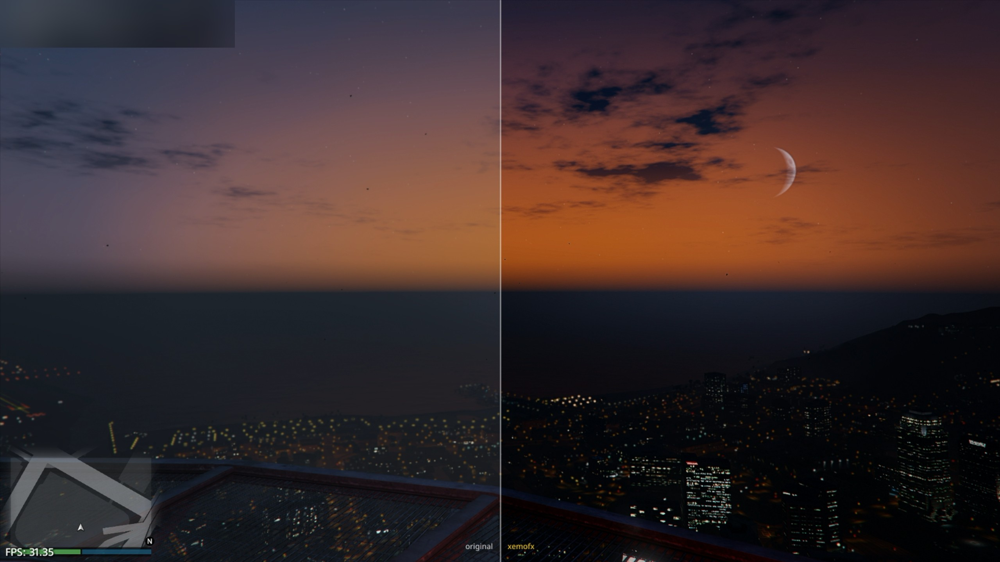](https://youtu.be/97cvkV1gIe4)

Watch it here: https://youtu.be/97cvkV1gIe4

## Screenshots

GTA V on PS4 Pro. The split ones are the built-in compare mode, original on the left, XeMoFX on the right.

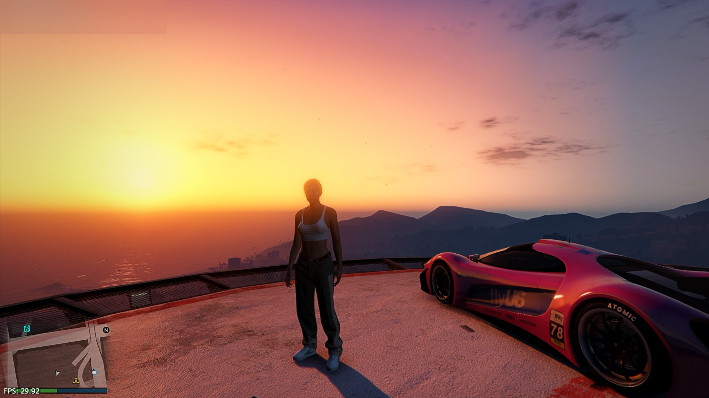

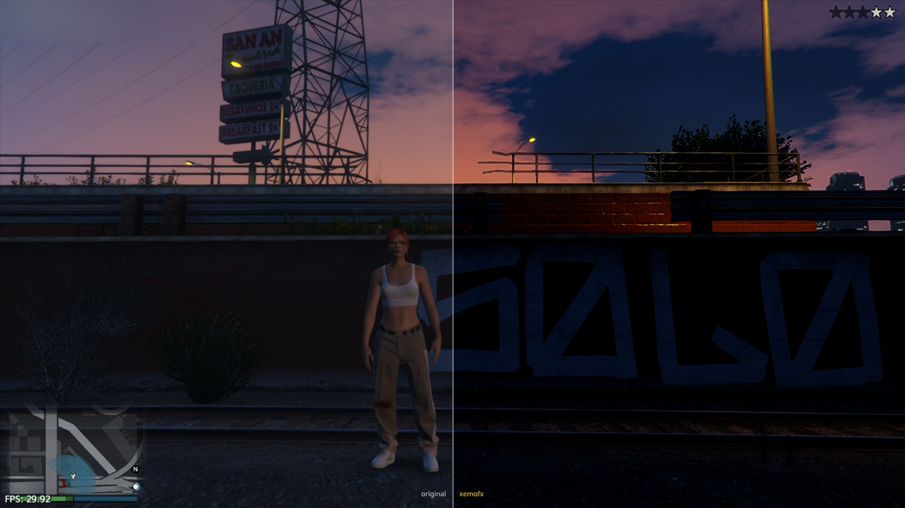

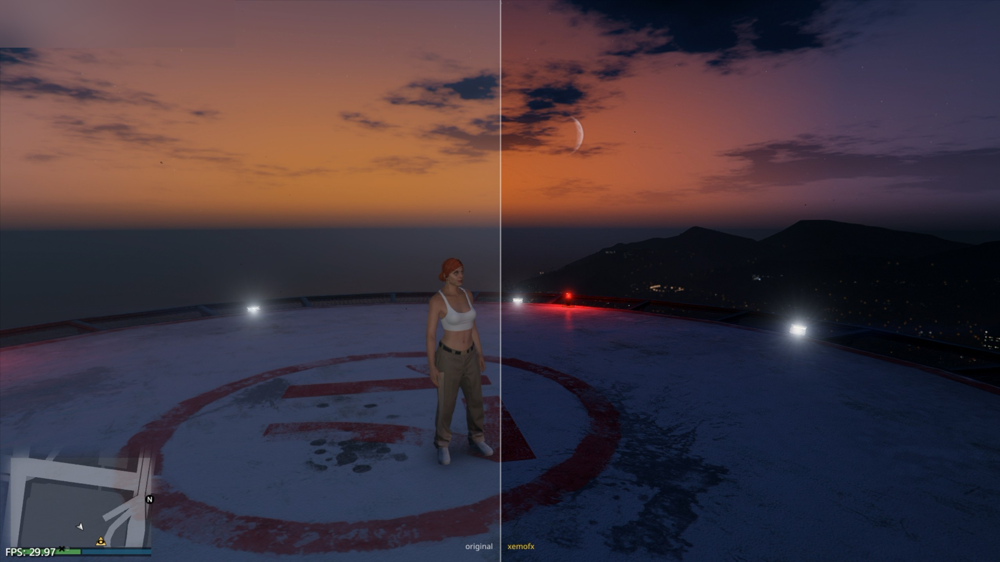


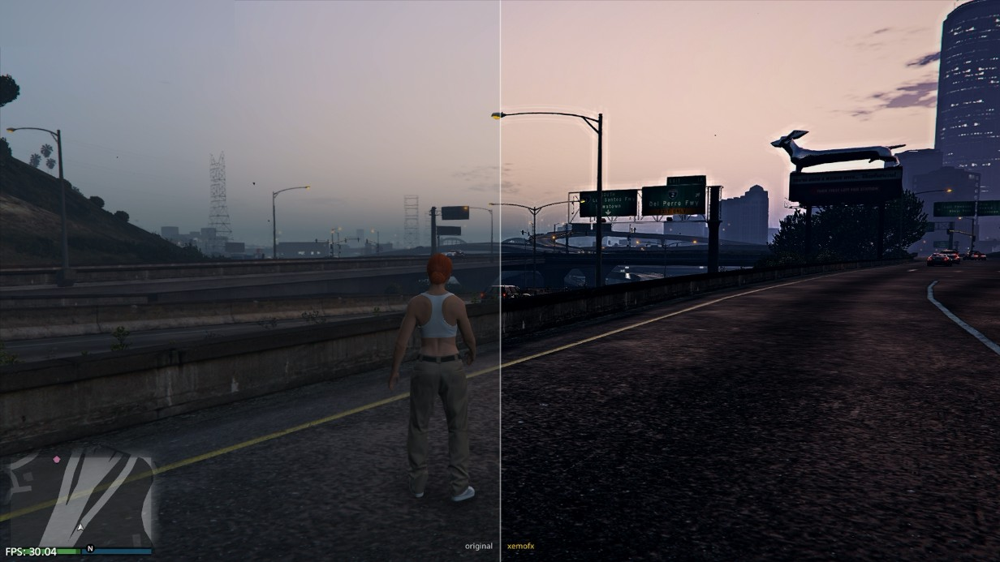

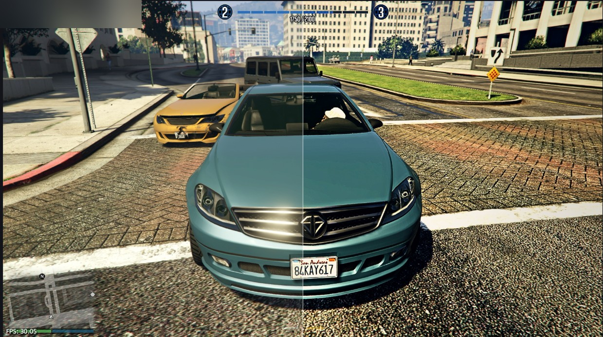

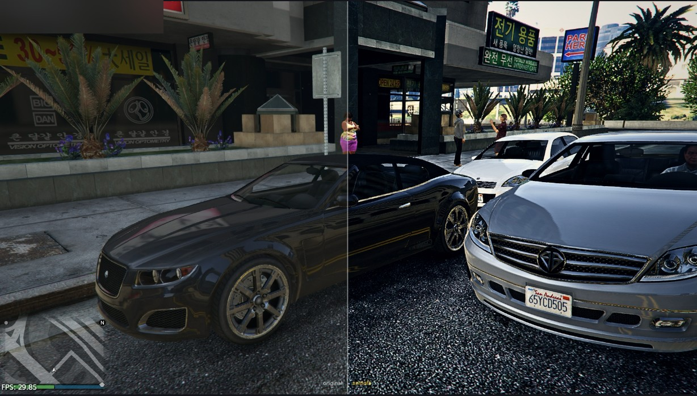

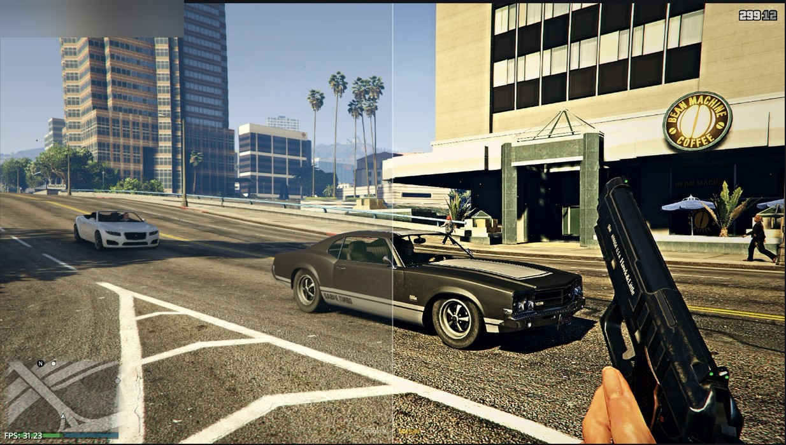

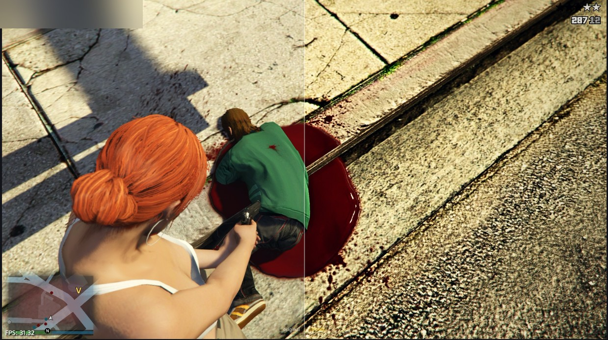

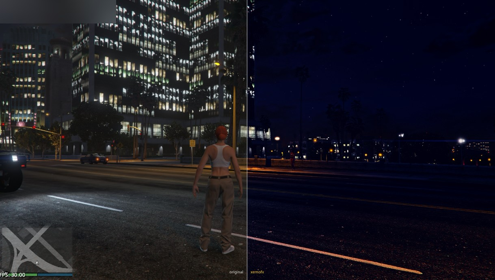

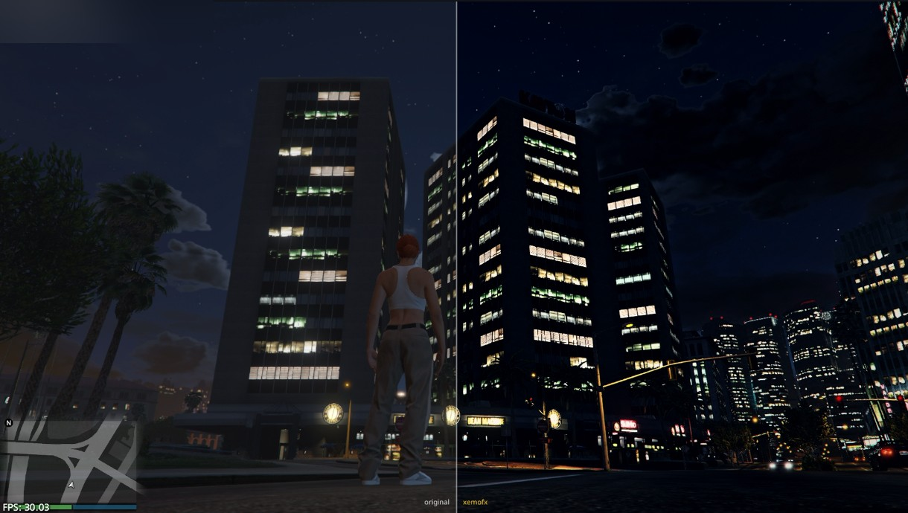

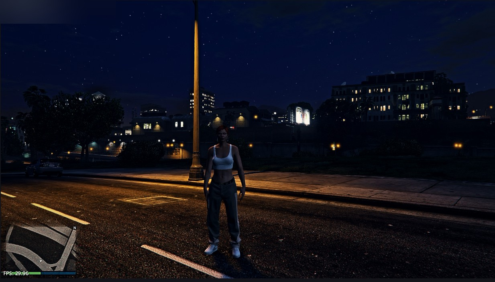

## What it does

**Detail**
- Sharpen (contrast adaptive, so no halos round edges)
- Clarity (local contrast in the mid-tones)
- Fake HDR (pulls detail out of dark and bright areas at the same time, gives the picture depth)
- Glow (bright bits bleed out a bit, cheap bloom)
- Deband (hides 8-bit colour banding in skies and fog)

**Colour**
- Saturation, vibrance (lifts dull colours more than ones that are already strong)
- Warmth, green / magenta tint
- Teal & orange (the blockbuster film look)
- Reds / greens / blues on their own (e.g. tone down GTA's over-green trees without touching skin)
- Shadow tint and highlight tint (cool shadows + warm highlights is what real light looks like)
- Hue shift
- **LUTs** - drop `.cube` or `.png` LUT files in `/data/GoldHEN/XeMoFX/luts/` and pick them in the menu, with a strength slider. Works on any game
- Colour blind correction: protan, deutan, tritan

**Light**
- Exposure, contrast, gamma, brightness
- Black level / white level (kills the grey washed-out blacks a lot of PS4 games have)
- Shadows and highlights, filmic S-curve

**Lens & film**
- Vignette, film grain, chromatic aberration, CRT scanlines
- Cinema bars (2.39, 2.00, 1.85)
- Filters: sepia, mono, night vision, thermal

**Distort**
- Fisheye, swirl, wave (+ frequency), RGB split, mirror
- Edge outline, emboss, VHS wobble, pixelate, posterize

**Other**
- Split screen compare (original on one side, XeMoFX on the other), stays on until you turn it off
- FPS counter
- 30 built-in presets, plus save your own, plus a random preset button
- Picks a good preset on its own the first time you load a game it knows (GTA V starts on Ultra Realism, racing games on Clean HD)
- Settings saved per game
- Menu combo can be changed in settings (L1, R1, L2 or R2 + Square) if it clashes with a game
- Load notification can be turned off
- Auto exposure (adjusts to bright / dark scenes like your eyes do) and night mode (lifts dark scenes), both optional
- Presets fade into each other instead of snapping
- Works if you inject it into a game that's already running, not just from plugins.ini

## Presets

**Realism:** Ultra Realism, Real Life, GTA Realism, GTA Photoreal, GTA HDR, GTA Real Sunny, GTA Golden Hour, GTA Overcast, GTA Night Neon, GTA Gritty, Dehaze, Clean HD

**Film / mood:** Cinematic, GTA Movie, GTA Cinematic, Noir, Retro, Faded Film, Dreamy, Warm, Cool, Lush

**Colour:** Natural, Vivid, Crisp, Hyper Vivid

**Fun:** Arcade CRT, Sepia, Night Vision, Thermal

**Ultra Realism** is the one to start with if you want it looking like real life. It's made for GTA V but works on pretty much anything.

## Controls

| Buttons | What |
|---|---|
| L1 + Square | open / close the menu (can be changed in settings) |
| Up / Down | pick a row |
| Left / Right | change it (hold to go faster) |
| X | open a page / press |
| Triangle | reset the value |
| Circle | back / close |
| R3 + Left | effects on / off (menu closed) |
| R3 + Right / Up | next / previous preset (menu closed) |

While the menu is open the game doesn't get your inputs.

## Install

**The easy way: the XeMoFX app**

1. Install `XeMoFX-App.pkg` from Releases (Debug Settings > Package Installer, or any pkg installer).
2. Open it and press **install / update**. That puts the plugin and all 10 XeMo LUTs on your console.
3. Go to **games** and turn XeMoFX on for the games you want. It lists every game in your plugins.ini.
4. Start the game. You'll get "XeMoFX - built & signed by XeMoisties", then press L1 + Square.

No account, no key, works offline.

**The manual way**

1. Copy `XeMoFX.prx` to `/data/GoldHEN/plugins/` on the console.
2. Add it under the game you want in `/data/GoldHEN/plugins.ini`:

```ini
[CUSA00411]
/data/GoldHEN/plugins/XeMoFX.prx
```

3. Unzip `XeMoFX-LUTs.zip` into `/data/GoldHEN/XeMoFX/` if you want the LUTs.
4. Start the game, then press L1 + Square.

It works alongside other plugins, just put it on its own line under the same title. You can also inject it into a game that's already running: you'll see "please wait" while it finds the screen, then "ready".

## LUTs

The release comes with 10 of my own LUTs: **XeMo Real Life, Teal Orange, Bleach Bypass, Warm Film, Cold Night, Mono Contrast, Kodak Cinema, Soft Overcast, Golden Hour, Neon Night.**

Any `.cube` file works too (or a `.png` LUT strip), from a LUT pack or exported from Photoshop, Resolve or Lightroom. Drop it in `/data/GoldHEN/XeMoFX/luts/` and it shows up under colour > lut next time the game starts.

## Config files

Everything lives in `/data/GoldHEN/XeMoFX/`:

- `presets/*.ini` - one file per preset. Built-ins get written here on first run so you can edit them. Drop your own `.ini` in here and it shows up in the menu.
- `<TITLEID>.ini` - what's on for that game (preset, effects on/off, compare, fps counter, menu side). Written by the plugin.
- `XeMoFX.ini` - optional global defaults, same keys as the per-game file.

A preset file is just `key = value`:

```ini
name = My Look
sharpen = 0.45
clarity = 0.30
black = 0.03
saturation = 0.95
vibrance = 0.20
teal_orange = 0.25
fake_hdr = 0.40
sat_greens = -0.10
shadow_tint = -0.15
highlight_tint = 0.20
letterbox = 0
filter = 0
```

Anything you leave out stays at its default.

## Game support

It's not made for one game, it hooks the PS4's own graphics calls, so in theory it works on loads of games. In practice it works on most but not all, because games don't all do things the same way.

Tested on a PS4 Pro in both Pro mode and normal mode. A normal PS4 uses the same path as a Pro in normal mode so it should be fine, it's just a weaker GPU so the heavier stuff (glow, chromatic) costs more.

**Why it works on some games and not others**

A game needs to do these four things the normal way:

1. **Show its frames with the standard flip call.** Most games do. Some (Borderlands 2 for one) put frames on screen a different way, XeMoFX never sees the frame so nothing happens.
2. **End each frame the standard way.** XeMoFX puts its pass right before the game's flip. If the end of the game's frame doesn't look like it expects (Castle Crashers is one) it won't risk it and switches off.
3. **Use a normal 8-bit screen.** A few games use a 10-bit screen. That's fine in normal mode, but 10-bit in PS4 Pro mode isn't supported yet (The Last of Us Remastered on a Pro).
4. **Leave a bit of GPU memory free.** It needs about 40-50 MB, more at 4K. Some big 4K Pro games (Tekken 7) take nearly all of it at startup, then you get "not enough free memory" instead of the effect.

Some games just don't like anything else drawing on the GPU at the end of their frame and hang (Rec Room 05.39, Terraria). Those need a different method and aren't supported.

**If it doesn't work in a game** you'll get a "XeMoFX can't draw in this game" message with the reason, and it leaves that game alone. It never half-applies or messes with the frame. Worst case is nothing happens. If a game freezes with it, just take the line out of plugins.ini for that game.

## Building

The source in this repo is **v1.0**. Newer versions are release-only, so building from here gives you v1.0.

You need:

- PS4 SDK 1.750 (headers, `orbis-psslc`, `orbis-clang`)
- Visual Studio 2012 build tools (the V110 platform toolset the SDK uses)
- Git for Windows (the shader script uses its bash + `xxd`)
- `make_fself.exe` dropped in `tools/` (signs the prx, not included here)

Then:

```bat
Shaders\build_shaders.bat
build_fx.bat
```

That gives you `build\XeMoFX.prx` (signed). `build_fx.bat /p:Configuration=Dev` makes a build that writes a log to `/data/GoldHEN/XeMoFX/XeMoFX.log`, handy if a game isn't working.

## How it works (short version)

- Hooks the game's flip, display buffer setup and pad reads by swapping the resolved import addresses, so there's no per-game offsets.
- On each flip it takes the game's last command buffer and rebuilds it as: the game's commands, then a copy of the finished frame, then one full screen pass that writes the graded image back, then the menu, then the game's own flip. Same number of buffers, nothing extra submitted.
- The display layout is read from the game's own render target registers. PS4 Pro "Neo" tiling isn't supported by the SDK textures so on Pro the shader reads the frame as raw memory and works out the tiling itself.
- There's a per-frame fence, so if the GPU is behind it skips the effect for that frame instead of waiting.

## More from XeMoisties

- **[xemoistiesgames.com](https://xemoistiesgames.com)** - XeMoNet, online for PS4 games that lost their servers, and everything else I make
- **[games.xemoistiesgames.com](https://games.xemoistiesgames.com)** - list of supported games

## Credits

- **XeMoisties** - XeMoFX, everything in `src/` and `Shaders/`
- [Dear ImGui](https://github.com/ocornut/imgui) by Omar Cornut (font atlas + draw lists for the menu), MIT
- [Noto Sans](https://github.com/notofonts/latin-greek-cyrillic) by Google / the Noto Project (menu font), SIL Open Font License 1.1
- [stb_image](https://github.com/nothings/stb) by Sean Barrett (PNG LUT loading), MIT / public domain
- GoldHEN team for the plugin loader

## License

Fork it, change it, carry it on, release your own builds, all fine. The rules: it has to stay free with the source up, keep the LICENSE, credit **XeMoFX by XeMoisties** with a link to [xemoistiesgames.com](https://xemoistiesgames.com), and say it's a continued version. No selling it, no paywalls or key systems, no putting it in paid or closed menus/plugins, and don't pass it off as your own. Full terms in [LICENSE](LICENSE).

© 2026 XeMoisties · [xemoistiesgames.com](https://xemoistiesgames.com)
